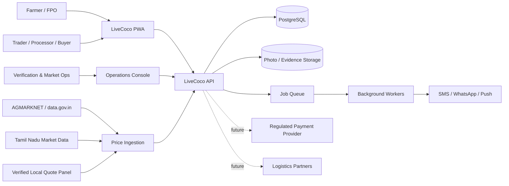
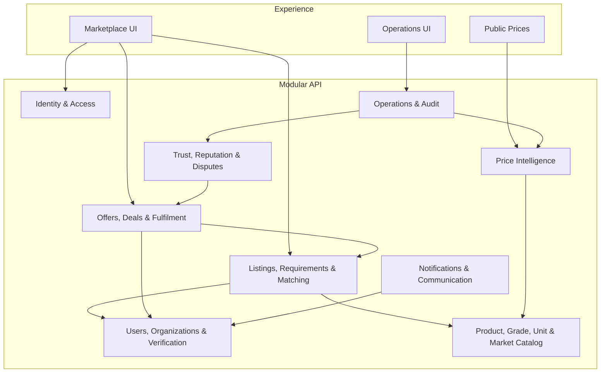
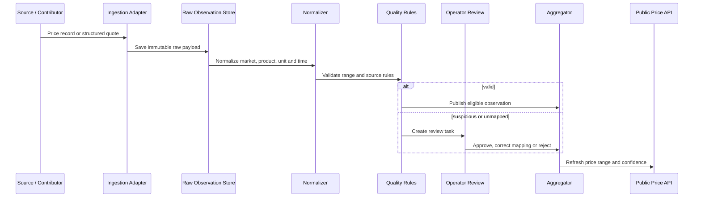
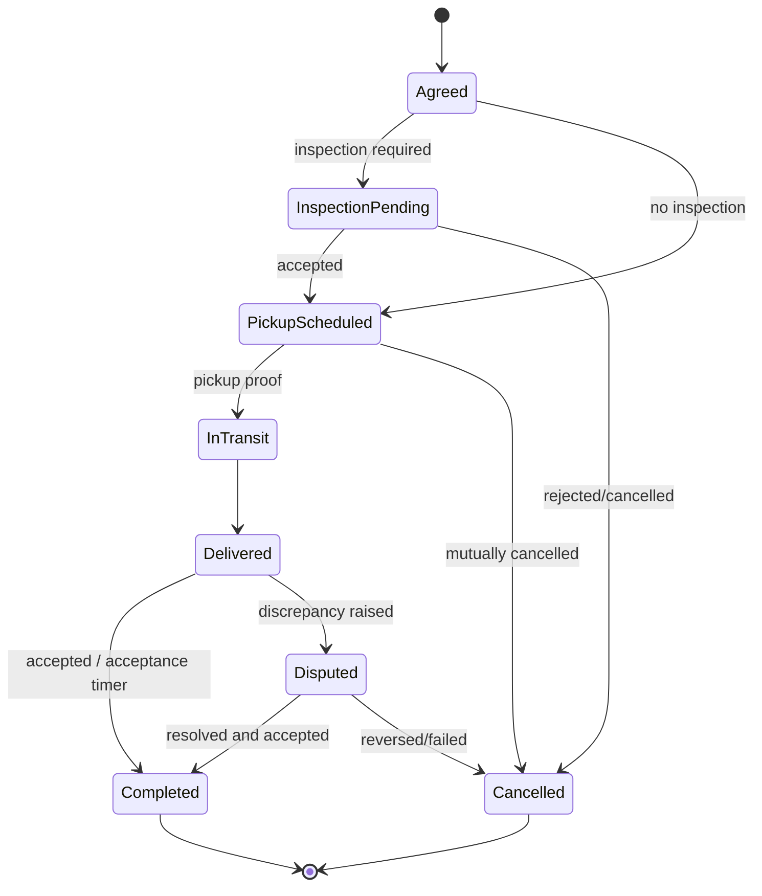
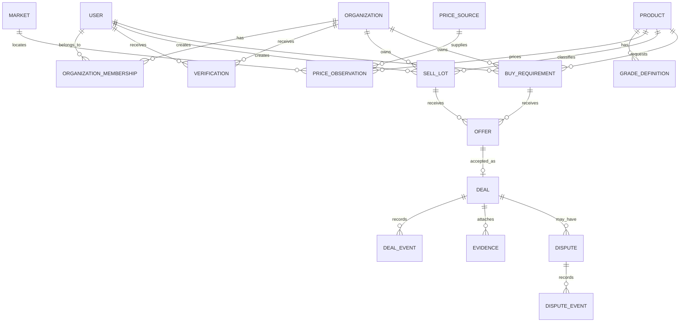
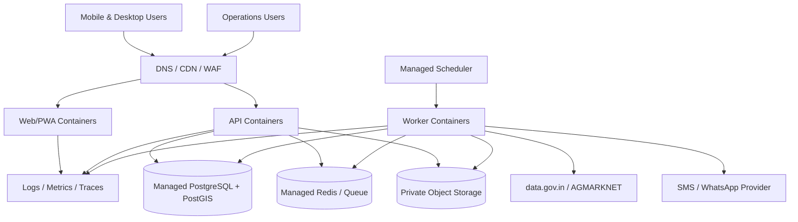

# LiveCoco Application Architecture

**Status:** Proposed architecture for MVP and first production release  
**Scope:** Tamil Nadu coconut price intelligence, verified B2B listings and assisted trade execution  
**Companion research:** [RESEARCH.md](./RESEARCH.md)

## 1. Architectural decision

Build LiveCoco first as a **modular monolith with asynchronous workers**, not as microservices.

This gives the product:

- One transactional database for prices, listings, offers and deals.
- Fast iteration while the marketplace workflow is still changing.
- Clear module boundaries that can later be extracted if scale or team ownership requires it.
- Reliable auditability without distributed-transaction complexity.
- Lower deployment and operating cost during the Pollachi pilot.

The first release consists of three deployable applications:

1. **Web application/PWA** — public prices plus authenticated farmer, buyer and FPO workflows.
2. **API application** — domain logic and integrations.
3. **Worker application** — ingestion, normalization, alerts, expiry and background verification jobs.

The operations console can initially be a protected area of the same web application. Separate it only when the operations team and permissions become materially different.

## 2. System context



## 3. Product surfaces

### Public price experience

- No login required.
- Searchable by product, market and date.
- Shows product/grade/unit, market stage, source, observed time and confidence.
- Separates official market observations, verified local quotes, MSP and estimated fair range.
- Optimized for search engines and WhatsApp sharing.

### Farmer and seller experience

- Mobile number and OTP onboarding.
- Tamil-first interface with English toggle.
- Create a sell lot through a short form, voice note or assisted operator call.
- See comparable prices before setting an expectation.
- Receive, reject and counter structured offers.
- Confirm pickup, weighment, delivery and completion.

### Buyer experience

- Buyer/business verification.
- Publish one-time or recurring requirements.
- Search or receive matched lots.
- Make time-limited offers with exact commercial terms.
- Save sourcing locations and preferred suppliers.
- Repeat a previous requirement or deal.

### FPO/cooperative experience

- Organization membership and role management.
- Aggregate multiple farmer lots while retaining member ownership.
- Bulk listing and buyer offer comparison.
- Member allocation, weighment and settlement export.

### Operations console

- User and organization verification.
- Market-source and contributor management.
- Price review and correction workflow.
- Listing moderation and assisted matching.
- Deal/dispute timeline with evidence.
- Fraud signals, account restrictions and audit search.

## 4. Logical module boundaries



### Dependency rule

Modules may call another module through its application interface, never by writing directly to another module’s tables. Database foreign keys can preserve integrity, but business mutations remain owned by their module.

### How the modules are implemented

[ADR-010](./docs/decisions/010-stateless-services-row-locked-units-of-work.md) describes this in full.

- **Code layout.** Each module is a folder in `apps/api/src/modules/` containing stateless services, one NestJS feature module and a thin controller. Pure business rules (state machines, validation, aggregation, matching) live in `packages/domain` and have no I/O.
- **Unit of work.** Every request or background job runs as one unit of work (`packages/database`). Services receive a `Scope` (the transaction, clock, correlation id and actor), read only the rows they need, and write explicitly. The writes are committed in one Postgres transaction. In a mutating request, the rows it reads are locked, so conflicting requests serialise on those rows and nowhere else.
- **No process state.** The API and the worker hold no state, so any number of each can run against one database. The worker calls the same services directly instead of going through HTTP.
- **Cross-module calls.** Modules call each other's services; they do not touch each other's collections. The dependency graph is acyclic and wired once in `apps/api/src/app.ts`.

## 5. Recommended technical stack

The confirmed stack is Next.js (web), NestJS (API) and Flutter (mobile) on PostgreSQL ([ADR-009](./docs/decisions/009-nextjs-nestjs-flutter.md)):

| Layer | Recommendation | Reason |
|---|---|---|
| Web | Next.js with TypeScript | Public price SEO plus app-like authenticated workflows |
| API | NestJS with TypeScript | Shared language, validation, clear dependency injection and background-job support |
| Mobile | Flutter (Android first) | Play Store reach for farmers and traders, offline-tolerant field workflows |
| Database | PostgreSQL with PostGIS | Transactions, flexible reporting and distance-based matching |
| Cache/queue | Redis-compatible managed service | Short-lived cache, rate limiting and background jobs |
| Search | PostgreSQL initially | Avoid separate search infrastructure until query volume proves the need |
| Object storage | S3-compatible private bucket | Listing photos, verification files and evidence |
| Authentication | OTP provider plus signed server sessions/tokens | Familiar farmer onboarding and centralized revocation |
| Messaging | Provider adapter for SMS and WhatsApp | Avoid locking domain logic to one vendor |
| Observability | Structured logs, traces, metrics and error reporting | Price provenance and transaction debugging are operationally critical |
| Deployment | Managed container service + managed PostgreSQL/Redis/storage | Low operations burden and clean path to scale |

The web stays responsive for public price pages and desktop buyers; the Flutter app is the primary field client.

## 6. Identity and authorization

### Account model

- A **User** is a person identified primarily by verified mobile number.
- An **Organization** is an FPO, cooperative, trader, processor, institution or logistics company.
- An **OrganizationMembership** assigns a user one or more organization roles.
- A person may act independently and for multiple organizations.

### Roles

- `farmer`
- `seller_agent`
- `buyer`
- `org_member`
- `org_manager`
- `price_contributor`
- `verifier`
- `market_operator`
- `dispute_operator`
- `administrator`

Use capability-based authorization behind these roles. For example, `deal.offer.create` is clearer and safer than scattering checks for `buyer` throughout the code.

### Verification levels

Keep verification claims separate:

- Mobile verified
- Identity verified
- Organization verified
- Applicable business documents verified
- Bank/payment destination verified
- Source/contributor verified
- Physical stock verified for a specific lot

Never display a generic “verified” badge that could imply all of these.

## 7. Price intelligence architecture

### Source tiers

1. `official_market` — AGMARKNET, regulated-market or formally supplied government data.
2. `policy_reference` — MSP/PSS and other official benchmarks.
3. `verified_quote` — current quote from an approved trader, processor, FPO or cooperative.
4. `completed_trade` — final price from a verified completed deal.
5. `community_report` — unverified submission, excluded or heavily down-weighted in public aggregates.

### Ingestion flow



### Raw versus normalized records

Never overwrite the source payload. Store:

- Raw response body or contributor submission.
- Source identity and retrieval time.
- Hash/idempotency key.
- Parser version.
- Normalized product, grade, market and unit.
- Validation result and correction history.

This allows LiveCoco to explain a published number and reprocess history when normalization rules improve.

### Price observation model

Every observation requires:

- Product and optional grade.
- Original and normalized unit.
- Currency.
- Minimum, maximum and modal/quoted price as applicable.
- Market stage: farm-gate, mandi, wholesale, processor purchase or retail.
- Location/market.
- Trade term: ex-farm, ex-yard or delivered.
- Included/excluded costs: harvest, dehusking, loading, commission, transport and tax.
- Observation time, source publication time and ingestion time.
- Source tier and contributor.
- Available quantity and expiry for executable quotes.
- Verification and anomaly state.

### Unit policy

- Store money in integer paise.
- Store measured quantity in a decimal numeric type plus unit code.
- Preserve the original unit.
- Normalize weight-based prices to `INR_PER_KG` for comparison.
- Do not convert `INR_PER_NUT` to weight-based prices unless the lot has an observed average weight.
- Never combine mature coconut, tender coconut and copra in one aggregate.

### Aggregation

For each `(product, grade, market area, stage, trade term, unit, time window)` bucket:

1. Remove rejected, expired and duplicate observations.
2. Apply a reliability weight based on source tier and contributor history.
3. Apply freshness decay.
4. Apply geographic and grade-distance penalties where relevant.
5. Compute weighted median and robust low/high percentiles.
6. Derive a confidence score from source count, diversity, freshness and dispersion.

Do not let repeated quotes from one organization masquerade as source diversity.

### Confidence response

The API should return factors, not only a score:

```json
{
  "range": { "lowPaise": 2900, "highPaise": 3200, "unit": "INR_PER_NUT" },
  "observedAt": "2026-10-01T09:15:00+05:30",
  "confidence": "medium",
  "evidence": {
    "sourceCount": 8,
    "organizationCount": 5,
    "officialObservations": 1,
    "verifiedQuotes": 6,
    "completedTrades": 1,
    "oldestObservationMinutes": 185
  }
}
```

## 8. Marketplace domain

### Sell lot

A sell lot represents produce controlled by a farmer, FPO or authorized agent.

State machine:

```text
DRAFT → PENDING_REVIEW → ACTIVE → RESERVED → SOLD
                         ↘ EXPIRED
                         ↘ WITHDRAWN
                         ↘ SUSPENDED
```

Required fields before activation:

- Seller/organization and declared ownership/agency relationship.
- Product, grade attributes and unit.
- Available quantity/range.
- Origin area and pickup precision appropriate to the user’s consent.
- Available-from and expiry time.
- Expected price or “invite offers.”
- Commercial terms and photos/evidence.

### Buy requirement

State machine:

```text
DRAFT → ACTIVE → PARTIALLY_FILLED → FILLED
          ↘ EXPIRED
          ↘ CANCELLED
          ↘ SUSPENDED
```

Supports one-time and recurring demand. Recurring requirements create dated requirement instances rather than remaining permanently “active.”

### Matching

MVP matching is deterministic and explainable:

- Same product.
- Grade compatibility.
- Quantity overlap.
- Availability window overlap.
- Maximum pickup/delivery radius.
- Seller/buyer verification policy.
- Price overlap when both sides specify one.
- Exclude blocked or previously disputed counterparties when policy requires it.

Return a scored candidate list to users and operators. Do not auto-create offers or deals.

## 9. Offer and deal architecture

### Structured offer

An offer contains the complete commercial proposal:

- Lot or requirement reference.
- Quantity and unit.
- Unit price and currency.
- Grade/quality basis.
- Pickup/delivery location and window.
- Who pays harvesting, dehusking, loading, commission and transport.
- Weighment/count method.
- Payment method and due time.
- Inspection/acceptance terms.
- Expiry time.

Counter-offers create a new immutable revision referencing the previous offer. Do not mutate negotiation history.

### Deal card

Accepting an offer creates an immutable commercial snapshot called the **Deal Card**. Subsequent operational updates do not silently alter it; material amendments require explicit acceptance by both parties and create a new revision.

### Deal state machine



Payment in v1 is recorded as a confirmation/evidence event and occurs directly between parties. LiveCoco must not represent payment as guaranteed.

## 10. Core relational model



### Key tables

#### Identity and organizations

- `users`
- `user_contacts`
- `organizations`
- `organization_memberships`
- `verification_cases`
- `verification_claims`
- `consents`

#### Catalog and geography

- `products`
- `product_aliases`
- `grade_definitions`
- `grade_attributes`
- `units`
- `markets`
- `locations`

#### Pricing

- `price_sources`
- `price_contributors`
- `raw_price_records`
- `price_observations`
- `price_review_tasks`
- `price_aggregates`
- `price_corrections`

#### Trading

- `sell_lots`
- `sell_lot_attributes`
- `buy_requirements`
- `requirement_attributes`
- `matches`
- `offers`
- `offer_revisions`
- `deals`
- `deal_revisions`
- `deal_events`
- `inspections`
- `weighments`
- `shipments`
- `payment_confirmations`

#### Trust and operations

- `evidence_files`
- `reputation_events`
- `disputes`
- `dispute_events`
- `risk_signals`
- `moderation_actions`
- `audit_events`
- `outbox_events`

### Audit rule

Every privileged operation and every change affecting price publication, verification, commercial terms or dispute resolution writes an append-only audit event containing actor, action, target, before/after summary, reason and request correlation ID.

## 11. API design

Use versioned JSON REST APIs for the initial product. Add event/webhook integrations where needed; GraphQL is unnecessary for the MVP.

### Public endpoints

```text
GET  /v1/catalog/products
GET  /v1/markets
GET  /v1/prices/latest
GET  /v1/prices/history
GET  /v1/prices/:aggregateId/evidence-summary
GET  /v1/policy/copra-msp
```

### Identity and profile

```text
POST /v1/auth/otp/request
POST /v1/auth/otp/verify
POST /v1/auth/logout
GET  /v1/me
PATCH /v1/me
POST /v1/organizations
POST /v1/organizations/:id/members
POST /v1/verifications
```

### Marketplace

```text
POST /v1/sell-lots
GET  /v1/sell-lots
GET  /v1/sell-lots/:id
POST /v1/sell-lots/:id/publish
POST /v1/sell-lots/:id/withdraw

POST /v1/buy-requirements
GET  /v1/buy-requirements
POST /v1/buy-requirements/:id/publish
POST /v1/buy-requirements/:id/cancel

GET  /v1/matches
POST /v1/offers
POST /v1/offers/:id/counter
POST /v1/offers/:id/accept
POST /v1/offers/:id/reject
```

### Deal execution

```text
GET  /v1/deals/:id
POST /v1/deals/:id/amendments
POST /v1/deals/:id/inspection
POST /v1/deals/:id/pickup-proof
POST /v1/deals/:id/delivery-proof
POST /v1/deals/:id/accept
POST /v1/deals/:id/payment-confirmation
POST /v1/deals/:id/disputes
```

### Operations

```text
GET  /v1/ops/review-queues
POST /v1/ops/price-observations/:id/approve
POST /v1/ops/price-observations/:id/reject
POST /v1/ops/verifications/:id/decide
POST /v1/ops/listings/:id/moderate
POST /v1/ops/disputes/:id/resolve
```

### API rules

- Every create command accepts an idempotency key.
- Use cursor pagination for mutable feeds.
- Return machine code, localized message key and correlation ID for errors.
- Use optimistic concurrency/version fields for mutable records.
- Never accept a client-supplied verification state or calculated reputation.
- Generate upload URLs only after authorization and validate uploaded type/size server-side.

## 12. Asynchronous events and jobs

Use a transactional outbox: the API commits domain changes and an `outbox_event` in the same database transaction. A worker publishes/processes the event after commit.

Important events:

- `PriceObservationAccepted`
- `PriceAggregateChanged`
- `SellLotPublished`
- `BuyRequirementPublished`
- `MatchCandidateCreated`
- `OfferCreated`
- `OfferExpiring`
- `OfferAccepted`
- `DealStateChanged`
- `DisputeOpened`
- `VerificationDecided`
- `RiskSignalRaised`

Background jobs:

- Official price-source polling.
- Raw-record normalization and reprocessing.
- Quote expiry and listing reconfirmation.
- Matching refresh.
- Alert fan-out and retry.
- Acceptance/payment reminder.
- Media malware scan and metadata stripping.
- Aggregate refresh and anomaly detection.
- Retention and deletion workflows.

All jobs must be idempotent and safe to retry.

## 13. Notifications and communications

The domain emits communication intents; a provider adapter decides whether to send SMS, WhatsApp or push according to consent, language and urgency.

Notification classes:

- Transactional security: OTP, login and verification change.
- Marketplace: new matching lot/requirement and offer activity.
- Deal operations: pickup, delivery, acceptance and payment reminders.
- Price alerts: chosen product/market threshold or scheduled bulletin.
- Operational: document request or dispute update.

Never send sensitive verification details or exact farm coordinates through notification text. All non-essential alerts require an easy opt-out.

## 14. Security and privacy architecture

### Baseline controls

- TLS for every connection and encryption at rest for managed data stores.
- Field-level encryption for high-risk identity and bank data.
- Passwordless OTP with attempt limits, device/IP risk checks and replay protection.
- Short-lived sessions/tokens with server-side revocation.
- Strict role/capability checks on the server.
- Private object storage with short-lived signed access.
- Malware scanning, safe image decoding and metadata stripping.
- WAF, request limits and bot protection on public write endpoints.
- Secrets stored in a managed secret service, never in source control.
- Separate production and non-production accounts and datasets.
- Database backups plus tested point-in-time recovery.

### Privacy model

- Store coarse public location; reveal precise pickup location only after an authorized deal stage.
- Collect only verification data required for a defined claim.
- Record notice version, purpose and consent/authorization state.
- Separate analytics identifiers from personal identity.
- Define retention by data class; evidence and financial records may need longer retention than abandoned drafts.
- Support access, correction, account closure and applicable erasure workflows.
- Redact personal data in logs and analytics.

### Marketplace abuse controls

- Duplicate-image and duplicate-phone signals.
- Velocity limits for listings, offers and contact reveals.
- Unrealistic price/quantity anomaly detection.
- Contributor-collusion signals for price manipulation.
- Stock verification sampling for high-volume lots.
- Block and report controls.
- Operator decision reasons and appeal records.

## 15. Caching and consistency

- Public price aggregates may be cached at the edge for 1–5 minutes.
- Catalogs and market lists may be cached longer with versioned invalidation.
- Listings and requirements can use short query caches but must show authoritative status from the primary database before offer/accept actions.
- Offers, deals, verification and disputes require primary-database reads/writes.
- Never cache authorization decisions across membership or suspension changes without explicit invalidation.

## 16. Reliability and observability

### Initial service objectives

- Public price pages: 99.9% monthly availability.
- Authenticated marketplace: 99.5% monthly availability during pilot.
- Price-source ingestion: process eligible source records within 15 minutes of retrieval.
- Notification dispatch: 95% of transactional messages handed to provider within 60 seconds.
- No acknowledged deal event lost.

### Required telemetry

- Structured log with correlation ID, actor type and domain operation.
- Distributed trace from API request through job and notification.
- Metrics for request latency/error, queue age, job retries, source freshness and notification failures.
- Business metrics for published lots, qualified matches, offers, completed deals and disputes.
- Alerts for stale price sources, ingestion drops/spikes, suspicious price changes, queue backlog and failed backups.

Create an operator-facing “data health” view that shows each source’s latest successful retrieval, latest observed market date, mapping errors and unpublished-review count.

## 17. Deployment topology



Use separate development, staging and production environments. Production changes require database migration checks, health checks and automated rollback for application deployments. Database rollbacks should use forward-compatible corrective migrations rather than destructive reversions.

## 18. Repository structure

```text
live-coco/
  apps/
    web/                 # public prices, marketplace and ops UI
    api/                 # modular HTTP API
    worker/              # ingestion, jobs and notifications
  packages/
    domain/              # domain types, state machines and policies
    database/            # schema, migrations and repositories
    contracts/           # API schemas and generated clients
    ui/                  # shared accessible components
    localization/        # Tamil and English message catalogs
    observability/       # logging, tracing and metrics helpers
    test-support/        # factories and integration-test utilities
  infrastructure/
    environments/
    modules/
  docs/
    decisions/           # architecture decision records
    api/
    operations/
  RESEARCH.md
  ARCHITECTURE.md
```

## 19. Testing strategy

- Unit tests for grade compatibility, unit normalization, state transitions and authorization policies.
- Property-based tests for money/unit conversion and price aggregation invariants.
- Contract tests for each external price adapter.
- Integration tests against a real ephemeral PostgreSQL instance.
- End-to-end tests for OTP, listing, offer, deal and dispute critical paths.
- Security tests for authorization boundaries, upload handling and rate limits.
- Replay tests using saved raw price-source payloads.
- Tamil localization review by native users; do not rely only on automated translation.
- Operations drills for stale source, failed notification provider, suspicious quote spike and restoration from backup.

## 20. Delivery phases

### Phase 0 — concierge validation

- Structured spreadsheet/database for verified quotes.
- Operations-only quote entry.
- Public read-only price bulletin.
- Manual matching by phone/WhatsApp.

Exit condition: repeat buyers and enough daily source diversity to publish credible ranges.

### Phase 1 — price intelligence MVP

- Product/market catalog.
- AGMARKNET adapter and raw/normalized price pipeline.
- Verified contributor quote entry.
- Price aggregation, confidence and public history.
- Tamil/English PWA and alerts.
- Source health console.

### Phase 2 — assisted marketplace

- Users, organizations and verification claims.
- Sell lots, buy requirements, deterministic matches and structured offers.
- Deal Card, event timeline and assisted operations.
- Evidence uploads and basic reputation events.

### Phase 3 — fulfillment confidence

- Inspection, weighment, pickup/delivery proof and disputes.
- FPO aggregation and settlement export.
- Logistics quote/referral integration.
- Repeat requirements and supplier relationships.

### Phase 4 — managed commerce

- Regulated marketplace payment/settlement provider after legal review.
- Reconciliation and refund/dispute integration.
- Advanced procurement tools and partner APIs.
- Extract services only where demonstrated load or ownership warrants it.

## 21. Decisions intentionally deferred

- Native Android versus PWA wrapper.
- Platform-managed payment and escrow-like flows.
- Credit/financing.
- AI image grading.
- Independent search engine.
- Data warehouse versus replicated analytics database.
- Service extraction.
- Statewide logistics orchestration.

Each deferred decision needs production evidence or a validated business requirement before adding complexity.

## 22. First implementation slice

The first end-to-end build should be deliberately narrow:

1. Catalog mature coconut, tender coconut, milling copra and ball copra.
2. Add Pollachi and a small set of nearby reference markets.
3. Ingest AGMARKNET records and preserve raw payloads.
4. Let approved operators/contributors enter structured current quotes.
5. Publish a sourced, time-stamped price range with confidence factors.
6. Add price-threshold alerts.
7. Measure freshness, source diversity and user return rate.

Only after that slice is reliable should the team implement sell lots and buy requirements. Price trust is the acquisition product; trade execution becomes the retention and revenue product.

