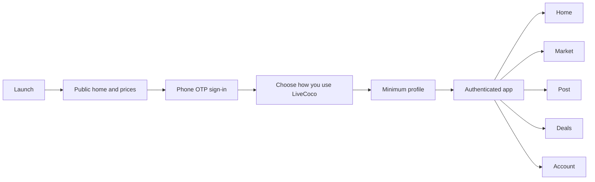
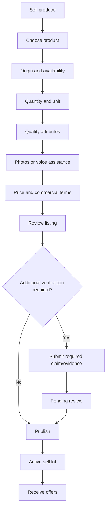
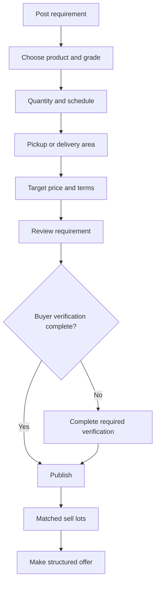
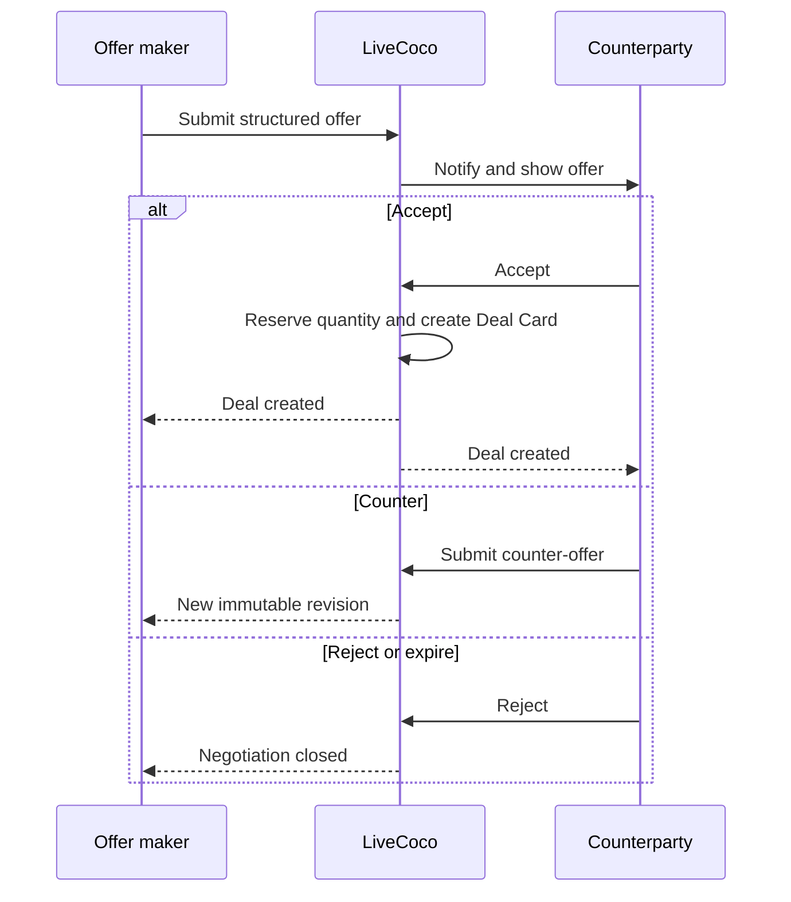
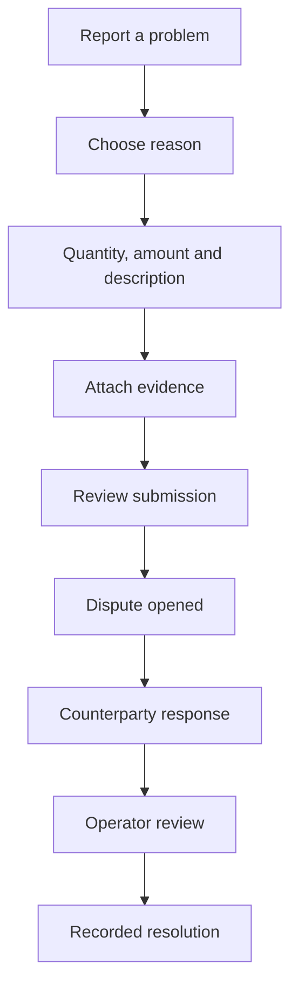

# Mobile application flow

**Primary platform:** Mobile-first PWA, designed for Android field use  
**Primary languages:** Tamil and English  
**Primary roles:** Farmer/seller, buyer/trader/processor, FPO/cooperative member  
**Supporting role:** LiveCoco operator through a separate protected console

## 1. Navigation model

The authenticated mobile application uses five primary destinations:

1. **Home** — current local prices, alerts and recommended next actions.
2. **Market** — sell lots, buy requirements and matched opportunities.
3. **Post** — role-aware shortcut to sell produce or post a requirement.
4. **Deals** — offers, active fulfilment and completed trades.
5. **Account** — profile, organizations, verification, language and support.

The center **Post** action is visually prominent but is not a separate information hierarchy. It opens a choice sheet:

- Sell produce
- Post buying requirement

Users who have only one eligible role go directly to the relevant flow.

## 2. Public and first-launch flow

### Screen M01 — Splash and initialization

Purpose:

- Show brand briefly while loading locale, cached catalog and session.
- Do not block on price-source or notification services.

Behavior:

- Existing valid session → authenticated Home.
- No session → public Home.
- No network → cached public Home with visible offline state.

### Screen M02 — Language selection

Shown on first use and always available from the header/account.

Options:

- தமிழ்
- English

Rules:

- The selection changes all primary navigation and transactional copy.
- Commodity names may show familiar bilingual aliases where research supports them.
- Language selection does not require sign-in.

### Screen M03 — Public Home

Sections in priority order:

1. Location/market selector.
2. Latest price cards for configured coconut products.
3. Freshness and confidence summary.
4. “View all prices.”
5. “Sell coconut” and “I want to buy” actions.
6. Short market bulletin/news.

Every price card shows:

- Product and grade summary.
- Low–high range or official observation.
- Unit.
- Market stage.
- Market/location.
- Observed/reported time.
- Confidence label.

Selecting a price opens M04.

### Screen M04 — Price details

Sections:

- Product, grade, unit and market-stage header.
- Latest evidence-backed range.
- Trend by reporting day.
- Evidence summary by source class.
- Included/excluded cost notes.
- Official policy reference such as MSP in a separate section.
- “Alert me” and “Sell this product” actions.

The screen must explicitly state that a market reference is not a guaranteed buyer offer.

### Screen M05 — Sign-in prompt

Triggered only for actions requiring an account, including alerts, posting and offers.

Fields/actions:

- Mobile number.
- Request OTP.
- Terms/privacy links.
- Assistance option.

### Screen M06 — OTP verification

- Six-digit code or provider-specific length.
- Resend timer.
- Change number.
- Clear, non-enumerating errors.
- Automatic code suggestion where the platform supports it safely.

Rate-limit states must offer support without revealing security thresholds.

## 3. Initial account setup

### Screen M07 — Choose role

Question: “What do you want to do on LiveCoco?”

Multi-select options:

- Sell coconuts from my farm
- Sell for an FPO/cooperative/business
- Buy or process coconuts
- Transport/inspection service — shown as “coming later” until enabled

Role selection configures shortcuts; it does not grant privileged verification.

### Screen M08 — Minimum profile

Required:

- Preferred name.
- Preferred language.
- District and area/village.

Optional until needed:

- Email.
- Exact address.
- Business information.

### Screen M09 — Organization choice

For organization-related roles:

- Join using an invitation.
- Create an organization.
- Continue independently.

Creating an organization asks for type and display name first; documents are requested only when required for an action.

### Screen M10 — Notification preference

- Price alerts.
- Offer and deal updates.
- WhatsApp/SMS/app notification choice where available.

Transactional security messages cannot be disabled while the account is active; marketing/bulletin preferences remain optional.

### Screen M11 — Setup complete

Shows one next action based on role:

- Farmer: Check today’s price or list produce.
- Buyer: Post a requirement.
- FPO: Add organization members or aggregate a lot.

## 4. Authenticated Home

### Screen M12 — Role-aware Home

Common sections:

- Current market/location.
- Price cards and alerts.
- Active actions requiring attention.
- Recent offers/deals.

Seller additions:

- Active lots.
- New matching buyers.
- “Sell produce.”

Buyer additions:

- Active requirements.
- New matching lots.
- “Post requirement.”

FPO additions:

- Organization selector.
- Member lots awaiting aggregation.
- Organization tasks.

No vanity statistics should displace current prices and required actions.

## 5. Farmer/seller flow

### Screen S01 — Choose product

- Mature coconut
- Tender coconut
- Milling copra
- Ball copra

Each option includes a short Tamil/English description to prevent category mistakes.

### Screen S02 — Origin and availability

- District, taluk/area and village.
- Use saved farm/collection point.
- Available-from date.
- Harvest/pickup window.
- Listing expiry.

Exact coordinates remain private. The public preview shows only the configured coarse area.

### Screen S03 — Quantity

- Approximate or measured.
- Value/range.
- Unit appropriate to product.
- Partial sale allowed.
- Minimum acceptable purchase quantity.

Changing product resets incompatible quantity and quality fields after confirmation.

### Screen S04 — Product-specific quality

Mature coconut examples:

- With husk/dehusked.
- Harvest date/maturity.
- Size/average weight if measured.
- Damaged/cracked/sprouted estimate.

Tender coconut examples:

- Variety/colour where used.
- Harvest age.
- Size/water-volume band.
- Stem condition.

Copra examples:

- Milling/ball.
- Moisture and oil content when assayed.
- Drying method.
- Mould/smoke/burn/foreign-matter condition.
- Assay evidence.

The form distinguishes “measured,” “estimated” and “not known.”

### Screen S05 — Photos and voice assistance

- Guided photo slots: overall lot, close-up, defects/grade evidence.
- Tamil voice note explaining the lot.
- “Call me for help” assisted-listing request.

Upload continues in the background where supported. Unscanned uploads remain private and cannot publish.

### Screen S06 — Expected price and terms

Shows the relevant latest reference range with source time.

Seller chooses:

- Invite offers.
- Expected unit price.
- Fixed asking price if enabled by policy.

Commercial terms:

- Ex-farm or delivered.
- Harvesting responsibility.
- Dehusking responsibility.
- Loading responsibility.
- Transport responsibility.
- Commission/tax notes where applicable.
- Preferred payment timing.

### Screen S07 — Review and publish

Displays the listing exactly as a buyer will see it, plus private fields marked separately.

Validations:

- Missing required fields.
- Incompatible unit/product.
- Implausible price warning without blocking legitimate exceptions automatically.
- Verification requirement.
- Consent to publish coarse location and listing details.

### Screen S08 — Listing status

Tabs/sections:

- Summary.
- Matches.
- Offers.
- Activity.

Actions depend on state:

- Edit/revise.
- Confirm still available.
- Share listing.
- Withdraw.
- Request operator help.

Material edits show which offers will become invalid.

## 6. Buyer flow

### Screen B01 — Product and grade

- Product selection.
- Required/acceptable grade attributes.
- Hard requirements versus preferences.

### Screen B02 — Quantity and schedule

- Target and minimum quantity.
- Unit.
- One-time or recurring.
- Required pickup/delivery window.
- Partial fulfilment allowed.

Recurring schedules create dated instances visible before activation.

### Screen B03 — Fulfilment area

- Buyer pickup radius from configured location, or seller delivery destination.
- Vehicle/access notes.
- Loading/unloading responsibility.

### Screen B04 — Price and payment terms

- Invite seller quotes or provide target/range.
- Current reference range shown contextually.
- Payment method and due condition.
- Inspection/weighment/count preference.

### Screen B05 — Review and publish

Shows public buyer summary, requirement details, verification claims and expiry.

### Screen B06 — Requirement status

Sections:

- Matches.
- Offers/negotiations.
- Filled versus remaining quantity.
- Activity.

Actions:

- Edit/revise future availability.
- Pause/cancel.
- Invite matched seller to negotiate.
- Repeat requirement.

## 7. Market discovery flow

### Screen M13 — Market landing

Two role-aware tabs:

- Produce for sale
- Buyers/requirements

Filters:

- Product.
- Location/radius.
- Quantity/unit.
- Available/required date.
- Grade.
- Verification claims.

Avoid a permanent dense filter panel; show active filters as readable text and open a filter sheet.

### Screen M14 — Lot details

- Product and grade.
- Quantity and availability.
- Coarse origin.
- Asking/invite-offer state.
- Commercial terms.
- Seller verification summary and platform outcomes after minimum sample threshold.
- Media.
- Relevant market reference.
- “Make offer” or “Request contact” action.

### Screen M15 — Requirement details

Equivalent buyer-side view with demand, destination/radius, schedule, terms and verification summary.

## 8. Offer and negotiation flow

### Screen O01 — Make offer

Pre-filled from lot/requirement where appropriate:

- Quantity.
- Unit price.
- Fulfilment window/location.
- Cost responsibilities.
- Inspection/count/weighment.
- Payment timing.
- Offer expiry.

Show estimated total and net-term summary, clearly labelled as estimated when final quantity is measured later.

### Screen O02 — Offer review

One concise commercial summary followed by expandable detail. Highlight differences from the referenced listing/requirement.

### Screen O03 — Negotiation thread

- Current actionable offer at top.
- Previous immutable revisions below.
- Accept, counter or reject.
- Call/contact action only when reveal policy permits.
- Expiry countdown based on server time.

Chat is not required for MVP; structured revisions and optional recorded operator assistance are preferred.

### Screen O04 — Acceptance confirmation

Before acceptance:

- Display complete terms.
- Warn that acceptance creates a deal.
- Require confirmation of material fields.
- Re-authenticate for high-risk or policy-defined deals if necessary.

If another user reserved the quantity first, show a conflict and return to updated availability without creating a duplicate deal.

## 9. Deal flow

### Screen D01 — Deal overview

Header:

- Deal status.
- Product, quantity and estimated/final value.
- Counterparty.
- Next required action and deadline.

Sections:

- Deal Card.
- Timeline.
- Evidence.
- Payment terms/status confirmation.
- Support/dispute.

### Screen D02 — Deal Card

Read-only accepted terms with revision selector. Material amendment starts a separate proposal flow and requires both parties.

### Screen D03 — Inspection

If required:

- Inspector/party.
- Scheduled time.
- Structured result and measurements.
- Evidence.
- Accept/reject/escalate according to agreed terms.

### Screen D04 — Pickup

- Scheduled date/time.
- Vehicle/contact information when authorized.
- Quantity/count at pickup.
- Weighment evidence.
- Pickup acknowledgement from appropriate party.

### Screen D05 — Delivery and acceptance

- Delivery proof.
- Final quantity/count.
- Buyer acceptance deadline.
- Accept delivery or report discrepancy.

### Screen D06 — Payment confirmation

Shows agreed method/due time and permits each party to record their own confirmation/evidence.

Wording must not imply LiveCoco processed, guaranteed or verified the payment unless a future regulated integration actually did so.

### Screen D07 — Deal complete

- Final terms/quantity/value summary.
- Outcome timeline.
- Repeat trade actions.
- Private structured feedback.

## 10. Dispute flow

### Screen X01 — Select issue

- Quantity/count difference.
- Quality/grade mismatch.
- Damage/contamination.
- Pickup/delivery failure.
- Unexpected deduction/charge.
- Payment delay/non-payment.
- Other.

### Screen X02 — Details and evidence

Product-specific fields, affected quantity/value, explanation and uploads. Show the agreed Deal Card terms alongside the form.

### Screen X03 — Dispute status

- Current stage and response deadline.
- Submitted claims/evidence visible according to policy.
- Operator requests.
- Resolution and reason when complete.

Emergency/safety contact should be separate from ordinary commercial disputes.

## 11. FPO/cooperative flow

### Screen F01 — Organization dashboard

- Organization verification.
- Members and roles.
- Member lots awaiting review.
- Aggregated lots.
- Active requirements/offers/deals.

### Screen F02 — Add member lot

Select existing member or create a limited member record with required authorization. Capture member-level product, quantity, unit, origin and quality.

### Screen F03 — Build aggregate lot

- Select compatible member lots.
- Show compatibility errors.
- Define allocatable total and tolerance.
- Preserve member contribution mapping.

### Screen F04 — Allocation and settlement

- Final accepted quantity by member.
- Deductions/cost allocation.
- Member payable calculation/export.
- Approval/audit depending on organization policy.

## 12. Verification flow

### Screen V01 — Verification center

Claims grouped as:

- Completed.
- Action required.
- In review.
- Expiring.

Each card names the exact claim, benefit/action it unlocks and evidence needed.

### Screen V02 — Evidence capture

- Document type.
- Camera/file capture.
- Quality/visibility check.
- Consent/purpose notice.
- Submit.

### Screen V03 — Verification result

- Approved with scope and expiry.
- More information required.
- Rejected with safe actionable reason.
- Appeal/support route.

## 13. Account, support and notification flows

### Screen A01 — Account

- Personal profile.
- Organizations and roles.
- Verification center.
- Saved locations.
- Notification preferences.
- Language.
- Privacy and account controls.
- Help/support.

### Screen A02 — Notifications inbox

Groups:

- Action required.
- Offers and deals.
- Price alerts.
- Verification/support.

Opening a notification deep-links to the exact resource and validates current authorization/state.

### Screen A03 — Help and assisted service

- Frequently asked questions.
- Request callback.
- Call support during configured hours.
- WhatsApp support where enabled.
- Report abuse/safety concern.

Support requests attach a safe context reference, not unrestricted screenshots/documents by default.

## 14. Offline and poor-network behavior

### Available offline

- Last successfully cached public price pages, clearly marked with observation time.
- Existing draft sell lot/requirement.
- Previously loaded Deal Card and timeline, read-only.
- Help information.

### Queued locally

- Draft form changes.
- Media selected for later upload.

### Never finalized offline

- Offer acceptance.
- Deal amendment acceptance.
- Verification decision.
- Dispute resolution.
- Payment confirmation submission.

These actions require the server to validate current state. The UI may preserve entered data but must confirm online before success.

## 15. Error and empty states

Every error state includes:

- What happened in plain language.
- Whether entered data was saved.
- Safe next action.
- Support path when the user cannot recover.

Important empty states:

- No current price evidence → show latest official observation separately and invite alert signup.
- No matching buyer/lot → preserve the post and explain how to broaden compatible criteria.
- No offers → show listing freshness and assisted-match option.
- Verification pending → show expected next step, not an invented completion time.

## 16. Notification-to-screen map

| Notification | Destination |
|---|---|
| Price threshold reached | M04 Price details |
| New lot match | M14 Lot details |
| New requirement match | M15 Requirement details |
| New/counter offer | O03 Negotiation thread |
| Offer expiring | O03 Negotiation thread |
| Offer accepted | D01 Deal overview |
| Pickup reminder | D04 Pickup |
| Delivery awaiting acceptance | D05 Delivery and acceptance |
| Payment due reminder | D06 Payment confirmation |
| Dispute response required | X03 Dispute status |
| Verification action required | V01 Verification center |

## 17. Analytics events

Analytics must not include phone numbers, document data, exact coordinates or free-text evidence.

Core events:

- `public_price_viewed`
- `price_evidence_opened`
- `price_alert_created`
- `onboarding_completed`
- `sell_lot_draft_started`
- `sell_lot_published`
- `buy_requirement_published`
- `match_opened`
- `offer_submitted`
- `offer_countered`
- `offer_accepted`
- `deal_stage_completed`
- `dispute_opened`
- `repeat_trade_started`

Each event uses pseudonymous actor/session ID, product/market IDs and coarse context only.

## 18. Accessibility and Tamil UX requirements

- All controls have visible labels; do not depend on placeholder text.
- Minimum practical touch targets for field use.
- Numeric keypad for price/quantity with explicit unit adjacent.
- Tamil translations are human-reviewed.
- Voice-note and callback options remain available where typing is burdensome.
- Status is communicated with text and icon, never color alone.
- Screen-reader reading order follows the action priority.
- Confirmation screens read the commercial unit and costs unambiguously.

## 19. MVP screen inventory

### Release A — price intelligence

- M01–M06
- M12 price-focused Home
- A01–A03 essentials
- V01–V03 for contributors/operators as needed

### Release B — assisted listings

- S01–S08
- B01–B06
- M13–M15
- Contact reveal and assisted-support states

### Release C — structured deals

- O01–O04
- D01–D07
- X01–X03

### Release D — FPO depth

- F01–F04

## 20. Flow acceptance checklist

Before implementing a mobile flow:

- Entry points and back behavior are defined.
- Required role/capability and verification claims are defined.
- Loading, empty, offline, expired and conflict states are designed.
- Sensitive fields and location disclosure are classified.
- Tamil and English copy exists.
- Analytics exclude sensitive content.
- Server state machine and mobile actions match.
- Operator-assisted recovery exists for the pilot’s critical tasks.

